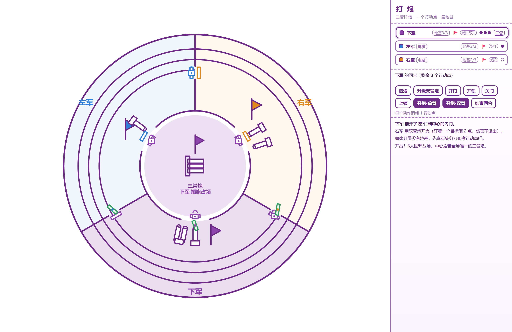

# 🔥 Fire Door · 打炮

一款单文件网页桌游：**双击 HTML 就能玩**，不装引擎、不联网、不用服务器。

[▶ 在线试玩](https://atg2006.github.io/fire-door/) · [完整规则](打炮-说明.md) · [设计说明](#关于)

<p align="center"></p>

## 一句话玩法

石头剪刀布赢行动点 → 修满三层地基 → 插旗 → 造炮 → **先开对方的门，再一炮轰进去**。

门才是这游戏的骨架：相邻两家之间是**两扇互相独立的单向门**。
*我开了你的门 ≠ 你能打我*——你想打我，得反过来花 1 点开我的门。
打赢一家后，他的地盘连同门一起归你，你就能从他的地盘继续往第三家打；中心的三管炮本质上也是一块要抢的占领区。

## 四种模式

| 模式 | 布局 | 中心三管炮 |
| --- | --- | --- |
| 双人对决 | 左右两个半圆 | 无 |
| 三人平分 | 三等分扇形 | 无 |
| 三人混战 | 圆环三等分 | 有，只能占领、打不坏 |
| 四人经典 | 圆环四等分 | 有，只能占领、打不坏 |

## 开炮伤害

| 炮 | 一次伤害 | 选目标 |
| --- | --- | --- |
| 单管炮 | 1 | 点一次 |
| 双管炮 | 2 | 只选一个目标，点一次 |
| 中心三管炮 | 3 | 只选一个目标，点一次 |

命中顺序固定 **炮 → 旗 → 地基**，伤害不溢出：把目标打穿就走，多的部分直接浪费。

## 本地运行

下载 `打炮.html` 双击即可，或者：

```bash
git clone https://github.com/atg2006/fire-door.git
cd fire-door
# 双击 打炮.html
```

## 操作

- 鼠标：点按钮，再点棋盘上闪烁的门 / 目标领地
- `1` `2` `3`：出拳（锤子 / 剪刀 / 布）
- `Enter`：结束回合；`Esc`：取消当前选择

## 目录

```
打炮.html        游戏本体（单文件，零依赖）
打炮-说明.md     完整规则与设计说明
index.html       跳转到 打炮.html 的入口（GitHub Pages 用）
art/             11 张手绘美术参考
docs/            截图
```

## 关于

规则来自朋友口述的一份原创桌游构想，配 11 张手绘草图；这里把它做成了可以在浏览器里直接对局的版本（含 AI）。
目前是 v1：AI 托管、本地热座多人，不支持联机。
